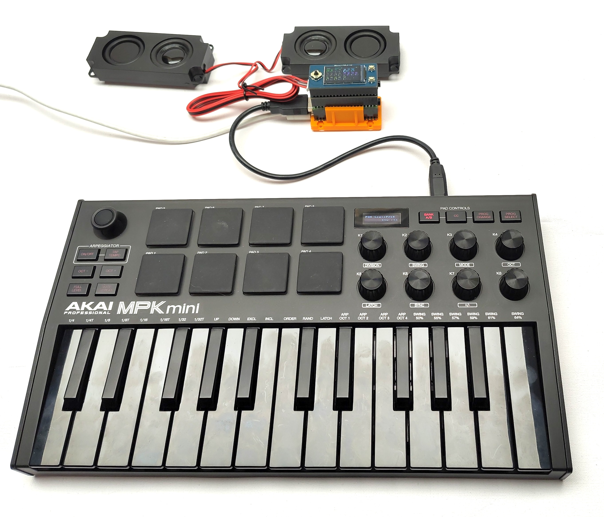
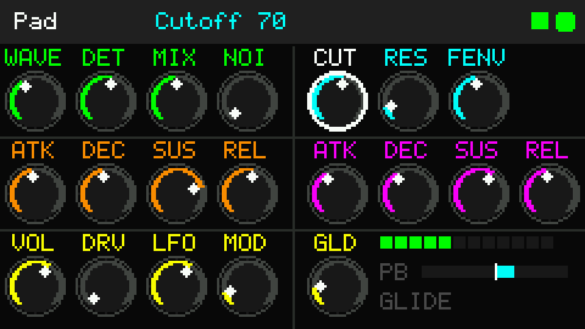
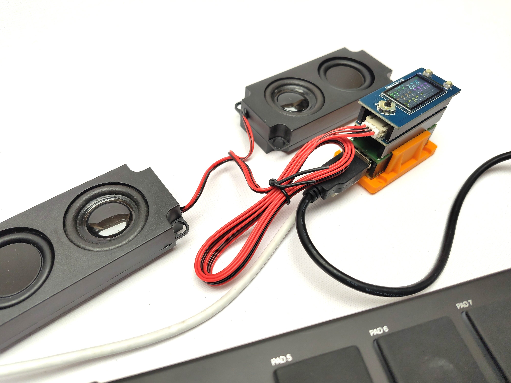
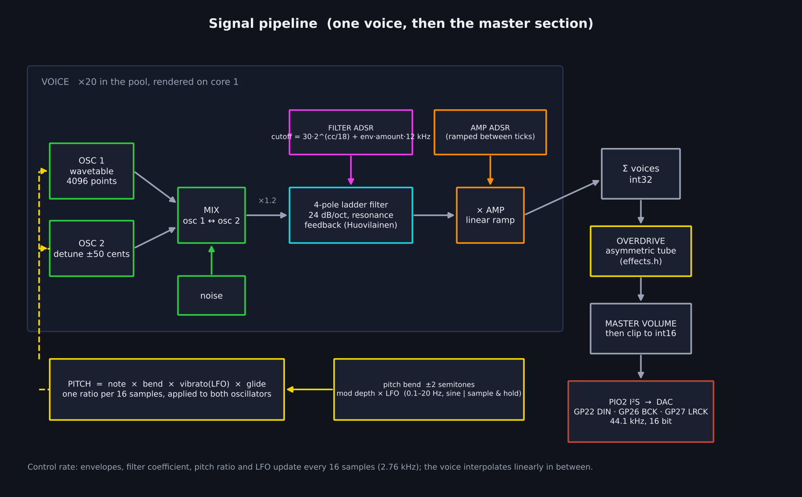
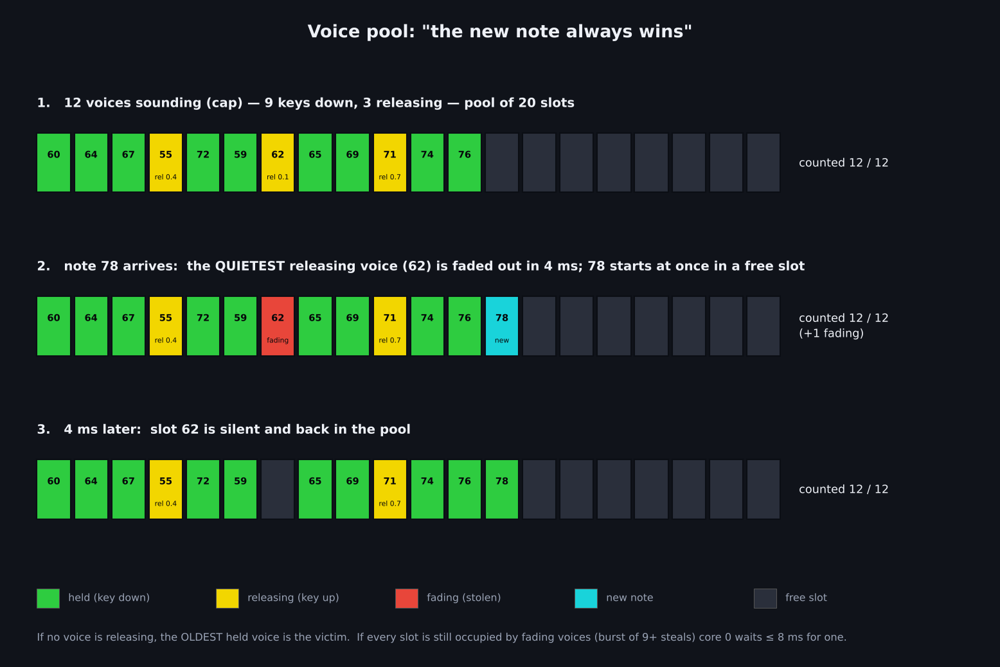
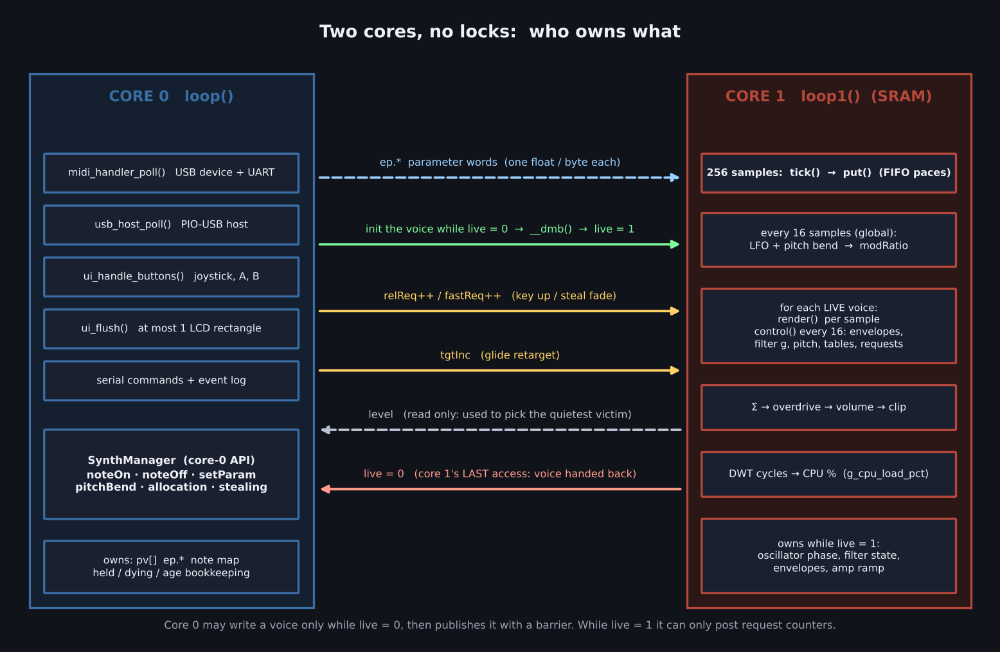
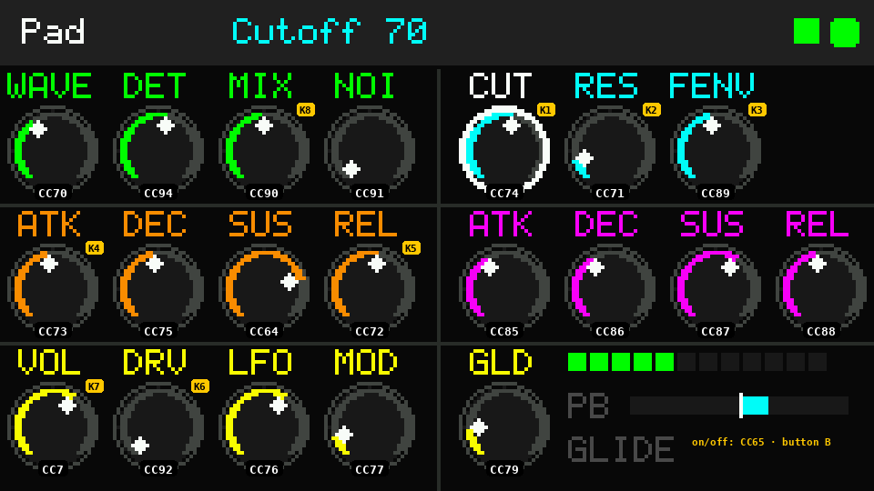

# Pico Analog Synth — Polyphonic Synthesizer (USB Host + LCD panel)



A polyphonic subtractive synthesizer for the Raspberry Pi Pico 2 (RP2350), using a Waveshare Pico-Audio Rev 2.1 DAC and a Waveshare Pico-LCD-1.14 display. It shares its platform layer (I²S audio, USB host, MIDI input, display driver) with the Pico Tonewheel Organ and receives MIDI from three simultaneous sources:

- **USB device** (Pico's native USB port) — PC, DAW, or USB MIDI controller
- **USB host** (GP6/GP7 socket) — one USB MIDI keyboard or controller (developed with an AKAI MPK mini)
- **UART** (GP5) — DIN-5 MIDI in, or a keyboard-scanner Pico

Per voice: two wavetable oscillators (+ noise) → 4-pole resonant ladder filter → amplifier, with two ADSR envelopes, an LFO for vibrato, pitch bend and optional mono glide. Master section: asymmetric tube overdrive → volume. **12 notes** sound at once (pool of 20 voices), and the **newest note always wins** when the limit is reached.



*The 240×135 control panel: 20 round knobs, a top bar with the selected parameter, and a status block. Rendered from the real firmware code through an ST7789 emulator.*

---

## Hardware

The boards stack exactly like the tonewheel organ:

```
[Pico-LCD-1.14]   ← top
[Pico-Audio]      ← middle
[USB and MIDI in] ← middle
[Pico 2]          ← bottom
```



The pcb files for the USB connector and MIDI input can be found in the [picotonewheel](picotonewheel) repository.

### Pin Assignments

**Pico-Audio Rev 2.1 (I²S — hard-wired on PCB, CS4344 DAC):**

| Signal | GPIO | Notes |
|--------|------|-------|
| I2S DIN | GP22 | Audio data |
| I2S BCK | GP26 | Bit clock |
| I2S LRCK | GP27 | Word select |

Audio uses **PIO2** to leave PIO0/PIO1 free for the USB host (TX = PIO0, RX = PIO1).

**Pico-LCD-1.14 (SPI1 — hard-wired on PCB):**

| Signal | GPIO |
|--------|------|
| SCK | GP10 |
| MOSI | GP11 |
| CS | GP9 |
| DC | GP8 |
| RST | GP12 |
| Backlight | GP13 |

**Pico-LCD-1.14 joystick & buttons** (active low, internal pull-ups):

| Input | GPIO |
|-------|------|
| Joystick UP | GP2 |
| Joystick DOWN | GP18 |
| Joystick LEFT | GP16 |
| Joystick RIGHT | GP20 |
| Joystick PRESS | GP3 |
| Button A | GP15 |
| Button B | GP17 |

**USB MIDI host (USB-A socket — wire yourself):**

| Signal | GPIO | Notes |
|--------|------|-------|
| D+ | GP6 | 15 kΩ pull-down to GND (host mode) |
| D− | GP7 | Direct |
| VBUS | 5V / VSYS | Powers the connected device |
| GND | GND | |

The USB host specification calls for 15 kΩ pull-downs on *both* data lines; the organ build documents D+ only. Fit both on new hardware.

**MIDI UART:** RX on **GP5** (31250 baud, `Serial2`).

---

## Building

### Environments

```
pico2_tone    — Pico 2 (RP2350, 240 MHz) — full build with USB host   ← use this one
pico2_nohost  — Pico 2 (RP2350, 200 MHz) — no USB host
pico_tone     — Pico 1 (RP2040)           — inherited from the organ, does NOT build audio:
                                            audio_driver.h uses PIO2, which only the RP2350 has
```

```bash
pio run -e pico2_tone --target upload
```

`lib/pio_usb/` must be the complete vendored library (14 files, including `pio_usb_ll.h`), otherwise TinyUSB's `hcd_pio_usb.c` fails with `pio_usb_ll.h: No such file`.

---

## Configuration (`config.h`)

`config.h` contains **only `#define`s** — no includes, no code. All user-facing values live here.

### Feature flags

```cpp
#define ENABLE_LCD        1
#define ENABLE_SERIAL     1
// ENABLE_USB_HOST defaults to 1; the pico2_nohost and pico_tone envs pass -DENABLE_USB_HOST=0
```

### Polyphony

```cpp
#define MAX_ACTIVE_VOICES  12   // notes that may sound at once (held keys + release tails)
#define SYNTH_POOL         20   // physical voice slots; the spare 8 let a stolen voice fade out
#define STEAL_RELEASE_MS    4   // fade time of a stolen voice
```

`SYNTH_POOL` must exceed `MAX_ACTIVE_VOICES` (compile-time check) and may not exceed 32. CPU worst case is `SYNTH_POOL` voices, but only for the few milliseconds of a steal. If the CPU square (see [Display](#display)) goes orange or red, lower `MAX_ACTIVE_VOICES` first.

### Sound

```cpp
#define CONTROL_DIV        16       // control-rate block, in samples (2.76 kHz)
#define VOICE_SCALE        4800     // per-voice peak (of 32767) at master volume 127
#define MOD_MAX_SEMITONES  2.0f     // vibrato depth at mod = 127
#define FILTER_MAX_HZ      12000.0f // nominal cutoff ceiling (stability limit, see below)
#define FILTER_CHEAP_SAT   0        // 1 = division-free filter saturator (unmeasured on the Pico)
```

### MIDI

```cpp
#define MIDI_CHANNEL             0   // 0 = OMNI
#define AKAI_REMAP               1   // CC1..CC8 = the eight knobs of an AKAI MPK mini
#define MIDI_PROGCHANGE_PATCHES  1   // program change selects a patch
```

---

## Sound engine



### Oscillators
Two phase-accumulator oscillators read a 4096-point single-cycle wavetable (sine, triangle, saw, square — one waveform for both). Oscillator 2 is detuned by up to ±50 cents and blended with **MIX**. White noise can be added (**NOI**, up to 40 %). The waveform is looked up once per control block, so turning **WAVE** changes held notes immediately. Waveforms are *not* band-limited (see [Known limitations](#known-limitations-and-next-steps)).

### Filter
A 4-pole, 24 dB/oct Moog-style ladder (Huovilainen topology: each stage `s += g·(sat(in) − sat(s))`, resonance fed back from stage 4). The cutoff is

```
nominal cutoff = 30 Hz · 2^(CUT/18)  +  FENV/127 · filter-envelope · 12 kHz        (limited to 12 kHz)
```

**Nominal is not the −3 dB point.** The one-pole stages use `g = tan(π f/fs)` as an Euler coefficient, which puts the real −3 dB point at roughly a quarter of the nominal value (measured on the firmware's own filter, resonance 0):

| nominal | 200 | 500 | 1000 | 2000 | 4000 | 8000 | ≥ 12000 |
|---|---|---|---|---|---|---|---|
| −3 dB at | 44 Hz | 111 Hz | 226 Hz | 473 Hz | 1050 Hz | 3326 Hz | fully open |

So the filter is deliberately dark and leans on its envelope for brightness. This is the sound the instrument was voiced with; changing the mapping changes every patch.

**Stability:** above ≈ 14 kHz nominal the coefficient is unstable (measured gain 2.8× at 16 kHz, 11.6× at 20 kHz). The ceiling `FILTER_MAX_HZ = 12000` removes that region; the filter is already fully open at that point, so nothing audible is lost. Each voice also checks its filter states once per control block and restarts the ladder if they ever run away (NaN or |s| ≥ 16).

### Envelopes
Two linear ADSRs per voice (amplitude and filter). Times are exponential in the CC value:

| value | 0 | 32 | 64 | 96 | 127 |
|---|---|---|---|---|---|
| time | 3 ms | 17 ms | 98 ms | 556 ms | 3 s |

Attack/decay/sustain are captured when a note starts. **Release is read when the key is lifted**, so you can turn the release knob while holding a chord and the next key-up uses the new time.

### Pitch, vibrato, glide
- **Pitch bend** ±2 semitones.
- **Vibrato:** one LFO (0.1–20 Hz, sine or sample & hold) × **MOD** depth (0 … ±2 semitones).
- **Glide** (button B / CC65): mono legato. While a key is held, a new key re-pitches the same voice (no retrigger) with an exponential glide of **GLD** time (5 ms … 3 s). After a gap the next note glides from the last pitch.

Bend, vibrato and detune are combined into one frequency ratio per 16 samples.

### Overdrive and level
The summed voices pass through the organ's asymmetric tube waveshaper (`effects.h`, shared file): positive and negative halves clip differently, giving even harmonics. **DRV** 0 = bypass, 1…127 = input gain ×1…×5 with output compensation. **VOL** is applied *after* the overdrive, so the drive character does not change with volume. At the default VOL 80 one voice peaks at about 3000 of 32767.

---

## Polyphony and voice stealing



Up to `MAX_ACTIVE_VOICES` voices *count* (held keys plus release tails). When another note arrives at the limit:

1. the **quietest voice whose key is already up** is the victim — otherwise the **oldest held** voice;
2. the victim gets a short **fast release** (`STEAL_RELEASE_MS`) and stops counting immediately;
3. the new note starts **at once in a free slot** — the pool has 8 spare slots exactly for this.

Nothing is ever overwritten while it sounds, so there are no clicks and no races. If a burst of 9+ simultaneous steals fills every slot with fading voices, core 0 waits at most 8 ms for one to finish; the note is never dropped. A note-off for a stolen note is ignored.

### Why there are no locks



Core 0 (MIDI, USB host, display, serial) only writes a voice while core 1 has handed it back (`live = 0`) and then publishes it behind a memory barrier. While a voice is live, core 0 can only increment request counters (release / fast release) and write a glide target. Core 1 owns the envelopes, filter and oscillators of a live voice outright. Every cross-core field is a single aligned word written by one side, so **neither core can ever wait for the other** — the audio loop cannot stall on a MIDI burst, and a key press cannot corrupt a sounding voice. (`spin_lock_blocking` is deliberately absent: it disables interrupts and loses USB-MIDI packets.)

---

## MIDI

All parameters are controlled through one table (`synth_params.h`); the panel, MIDI, serial and patches all go through it.

### Control change map

| Parameter | Serial name | Knob label | **MIDI CC** | Range / meaning |
|---|---|---|---|---|
| **Oscillators** | | | | |
| Waveform | `wave` | WAVE | 70 | sine / triangle / saw / square (0-31 / 32-63 / 64-95 / 96-127) |
| Detune | `det` | DET | 94 | osc 2 detune, 64 = 0, ±50 cents |
| Osc Mix | `mix` | MIX | 90 | 0 = osc 1 only … 127 = osc 2 only |
| Noise | `noise` | NOI | 91 | white noise, 0 … 40 % of full scale |
| **Filter** | | | | |
| Cutoff | `cut` | CUT | 74 | base cutoff, 30 Hz × 2^(v/18)  →  30 Hz … ~4 kHz (nominal) |
| Resonance | `res` | RES | 71 | resonance 0 … 0.95 (self-oscillation near the top) |
| Flt Env Amt | `fenv` | FENV | 89 | how far the filter envelope opens the filter, 0 … +12 kHz (nominal) |
| **Amp envelope** | | | | |
| Amp Attack | `aatk` | ATK | 73 | 3 ms … 3 s (exponential) |
| Amp Decay | `adec` | DEC | 75 | 3 ms … 3 s (exponential) |
| Amp Sustain | `asus` | SUS | 64 | sustain level 0 … 100 % |
| Amp Release | `arel` | REL | 72 | 3 ms … 3 s (exponential) |
| **Filter envelope** | | | | |
| Flt Attack | `fatk` | ATK | 85 | 3 ms … 3 s (exponential) |
| Flt Decay | `fdec` | DEC | 86 | 3 ms … 3 s (exponential) |
| Flt Sustain | `fsus` | SUS | 87 | sustain level 0 … 100 % |
| Flt Release | `frel` | REL | 88 | 3 ms … 3 s (exponential) |
| **Master / FX / mod** | | | | |
| Volume | `vol` | VOL | 7 | master volume (applied after the overdrive) |
| Drive | `drive` | DRV | 92 | 0 = bypass, 1…127 = input gain ×1 … ×5 (asymmetric tube shaper) |
| LFO Rate | `lfor` | LFO | 76 | 0.1 Hz … 20 Hz (exponential) |
| Mod Depth | `mod` | MOD | 77 | vibrato depth, 0 … ±2 semitones |
| Glide Time | `glide` | GLD | 79 | glide time, 5 ms … 3 s |
| LFO Wave | `lfow` | *(no knob)* | 78 | < 64 sine, ≥ 64 sample & hold |

Other messages:

| Message | Function |
|---|---|
| CC 65 | Glide on/off (≥ 64 = on) |
| CC 120 | All sound off (panic: everything fades in 4 ms) |
| CC 123 | All notes off (normal release) |
| Pitch bend | ±2 semitones |
| Program change | selects patch `n mod 3` |
| Velocity | ignored |

> **CC 64 is the amp *sustain level*, not a sustain pedal.** A pedal sending CC 64 will move the knob. Sustain-pedal support is on the to-do list.



*Every knob with its primary CC. Orange badges mark the AKAI MPK mini knob (K1…K8) that also reaches it.*

### AKAI MPK mini knobs

With `AKAI_REMAP 1`, CC1…CC8 always mean the eight knobs of an MPK mini in its factory program, and take precedence over the other numbers:

| Knob | CC | Controls |
|---|---|---|
| K1 | 1 | Cutoff |
| K2 | 2 | Resonance |
| K3 | 3 | Flt Env Amt |
| K4 | 4 | Amp Attack |
| K5 | 5 | Amp Release |
| K6 | 6 | Drive |
| K7 | 7 | Volume |
| K8 | 8 | Osc Mix |

With `AKAI_REMAP 0`, CC1 becomes the GM mod wheel and CC5 the GM portamento time instead. LFO rate, mod depth, LFO wave and glide time are reachable on CC 76–79 in either mode.

---

## Patches

Joystick **PRESS** cycles through three complete patches (each sets *every* parameter, so nothing leaks between patches); MIDI program change selects them too. Editing any parameter renames the patch to *Custom*.

| Parameter | Init | Pad | Bass |
|---|---|---|---|
| Waveform | saw | tri | sqr |
| Detune | 64 | 70 | 66 |
| Osc Mix | 0 | 64 | 0 |
| Noise | 0 | 0 | 0 |
| Cutoff | 60 | 70 | 50 |
| Resonance | 38 | 15 | 40 |
| Flt Env Amt | 90 | 60 | 100 |
| Amp Attack | 5 | 60 | 2 |
| Amp Decay | 50 | 60 | 40 |
| Amp Sustain | 80 | 100 | 100 |
| Amp Release | 30 | 70 | 20 |
| Flt Attack | 3 | 50 | 2 |
| Flt Decay | 60 | 50 | 30 |
| Flt Sustain | 25 | 80 | 40 |
| Flt Release | 40 | 60 | 20 |
| Volume | 80 | 80 | 80 |
| Drive | 0 | 0 | 0 |
| LFO Rate | 94 | 80 | 94 |
| Mod Depth | 0 | 15 | 0 |
| Glide Time | 20 | 20 | 20 |
| LFO Wave | 0 | 0 | 0 |

---

## Display

The panel is shown at the top of this document; the numbered figure with CC labels is in [MIDI](#midi).

### Top bar (y = 0..17)

```
[patch]   [selected parameter  value]                           [CPU] [MIDI]
```

- **Patch** — Init / Pad / Bass / Custom
- **Centre** — name and value of the selected knob, in that knob's group colour
- **CPU square** — green < 50 %, orange 50–79 %, red ≥ 80 % (measured on core 1 with the DWT cycle counter)
- **MIDI dot** — lights for 120 ms on note and CC messages

### Knob grid (y = 19..131)

Three rows × eight columns, colour-coded: **green** oscillators, **cyan** filter, **orange** amp envelope, **magenta** filter envelope, **yellow** master / FX / modulation. The selected knob has a white ring and label. Each knob shows its value as an arc from bottom-left to bottom-right with a white pointer.

### Status block (bottom right)

- **Voice pips** — one per counted voice (red when at the cap)
- **PB** — pitch-bend position, centred
- **GLIDE** — lit when glide is on

### Joystick and buttons

| Input | Action |
|-------|--------|
| LEFT / RIGHT | Select previous / next knob (wraps) |
| UP / DOWN | Increase / decrease: 2 per press; hold for repeat (after 350 ms, every 70 ms), step 8 after 700 ms. WAVE changes one waveform per press |
| PRESS | Next patch |
| Button A | **Panic** — silence everything |
| Button B | Glide on/off |

### Why the display does not disturb MIDI

Each widget redraws only when its own value changes, and only that rectangle goes to the panel as one bulk SPI transfer (a knob is ≈ 2 KB, the largest rectangle 8.6 KB ≈ 1.2 ms). At most **one** rectangle is sent per `loop()` pass, so USB and MIDI polling continue between rectangles; an idle panel sends nothing. The first full paint is 22 SPI calls.

---

## Serial commands

Connect at 115200 baud.

| Command | Effect |
|---------|--------|
| `help` | List all commands |
| `stat` | CPU load, voice counts, audio PIO state |
| `voices` | Every sounding voice: slot, note, envelope stage and level, held / released / fading |
| `params` | All parameter values with their CC numbers |
| `set <name> <0-127>` | Set a parameter by serial name, e.g. `set cut 70` |
| `cc <n> <0-127>` | Send a MIDI CC to the synth |
| `on <note>` / `off <note>` | Play / release a note |
| `patch <0-2>` | Load a patch |
| `glide on\|off` | Mono legato glide |
| `all` | Release all notes |
| `panic` | Silence everything now |
| `log notes\|cc\|all\|off` | Which incoming MIDI events are printed (default: notes) |
| `pio` | Audio PIO debug |

MIDI events are queued by the callbacks and printed from `loop()`, so a slow terminal can never delay the next MIDI message.

---

## USB host

One USB MIDI device on the host socket (direct or through a hub). Two devices simultaneously through a hub are not reliably supported with the vendored `pio_usb` v0.5.3. Practical workflow: keyboard on the USB host socket, a PC on the Pico's own USB port, optional hardware MIDI on GP5.

---

## Testing

The engine, filter and display are tested on a PC with the **real source files** and mocked Arduino/Pico headers (`host_test/`, built with g++ and AddressSanitizer + UBSan including float-cast-overflow).

```bash
cd host_test
./run_tests.sh          # full suite: filter, display and engine (includes the torture and two-thread tests)
./run_tests.sh quick    # fast pass
```

`run_tests.sh` stages the real sources (`stage.sh` swaps in mocks for just `audio_driver.h`, `midi_handler.h` and `usb_host.h`), builds with AddressSanitizer + UBSan and runs all three suites.

| Suite | What it checks |
|---|---|
| `test_filter` | New filter matches the previous one within 1 % at every cutoff; `tan` approximation error 0.036 %; bounded output at *any* requested cutoff (peak ≤ 1.16); NaN / runaway detection |
| `test_engine` | Parameter table; attack/sustain/release; polyphony cap and newest-note-wins; releasing voices stolen before held ones; pool exhaustion; same-note retrigger, duplicates and stale note-offs; glide and vibrato maths; every parameter swept at extremes; **250 000-event random torture** with invariants checked after every event; **two real threads** (audio flat out and real-time paced) with ≈ 1.3 million control events against 13 million samples |
| `test_lcd` | Emulates the ST7789 (decodes the real command/window stream): panel always equals the framebuffer, single-knob update = 6 SPI calls / 2 KB, idle = zero traffic, MIDI dot dims by itself, joystick repeat, patch cycling, debounce |

---

## Known limitations and next steps

- **Second DAC shield** — only the Rev 2.1 (CS4344) is supported. Boards with other DACs (CS4333, the PCM5101A "Initial Version") need their pin mapping checked against `AUDIO_DATA_PIN` / `AUDIO_CLOCK_PIN_BASE`; supporting two shields is postponed.
- **Chorus** — `effects.h` already contains the organ's dual-quadrature chorus; it only needs knobs and CCs.
- **Velocity** is ignored; **CC 64 is the amp sustain level** (no sustain pedal).
- **Aliasing** — the saw and square wavetables are not band-limited; high notes alias. The filter hides most of it.
- **Filter scale** — the nominal cutoff is about 4× above the real −3 dB point (see [Filter](#filter)).
- **`FILTER_CHEAP_SAT`** — removes five float divides per voice-sample; expected to help on the RP2350, not yet measured.
- **USB hub** with multiple devices — see [USB host](#usb-host).
- **RP2040 environment** does not build audio (PIO2).
