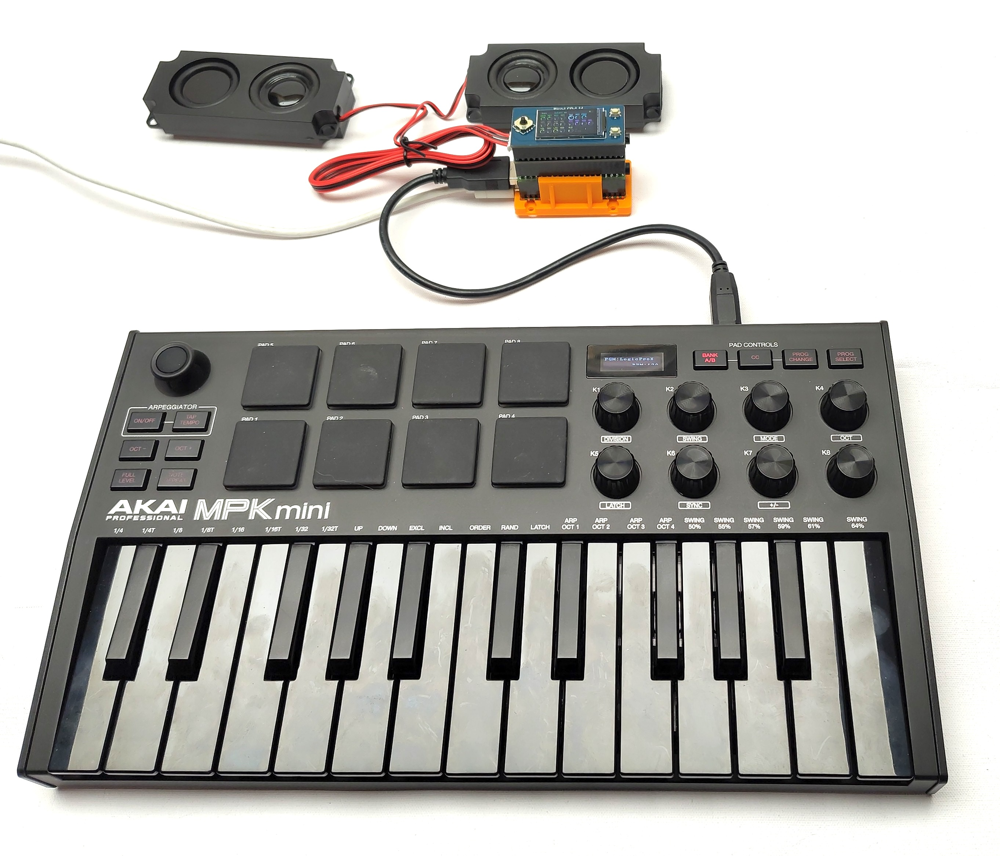
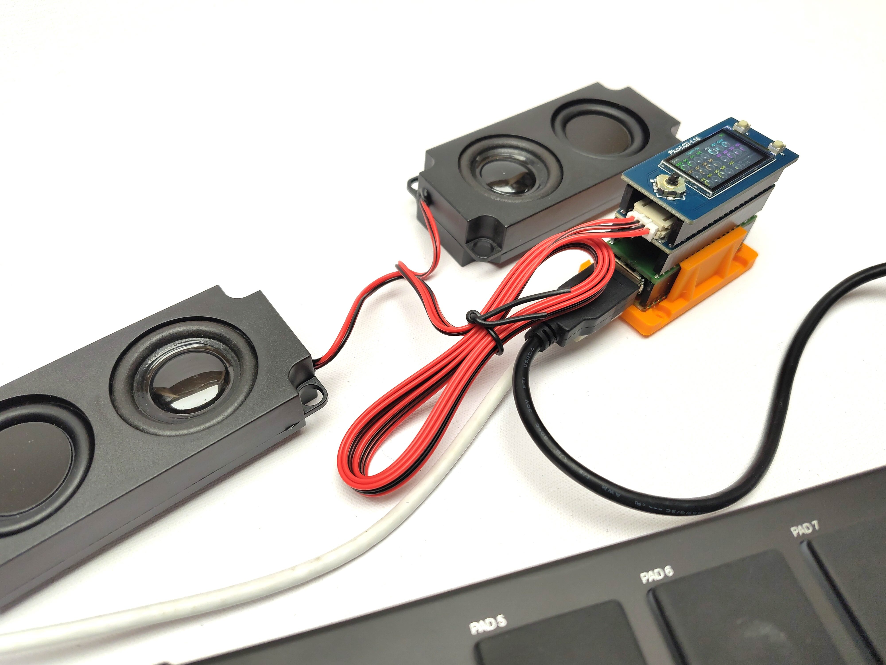
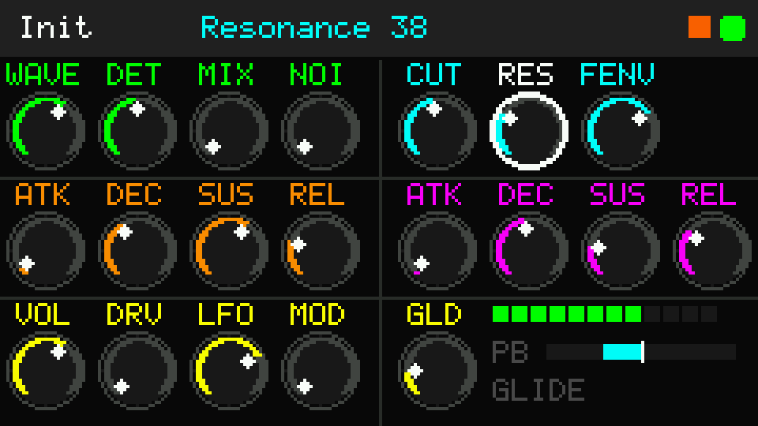

# Project Context — Pico Analog Synth (v3)

Hand-off document for the `picosynth` firmware. Read it together with `README.md` (user-facing: controls, CC map, panel) before changing anything. This file records the architecture, the rules that keep it correct, what was learned the hard way, how it is tested, and what is open.

State as of **November 2026**: the restored v3 build runs on the hardware (Pico 2, Waveshare Pico-Audio Rev 2.1, Pico-LCD-1.14, AKAI MPK mini on the USB host). Stuck notes, broken voice stealing, lag and the missing display reported against v2 are resolved. Both Waveshare Pico-Audio versions (Rev 2.1 / CS4344 and Initial Version / PCM5101A) are supported through `AUDIO_BOARD_REV2_1` and verified on hardware; the same driver has been ported to the tonewheel organ. Not yet recorded: measured CPU load on the Pico (see [Open items](#15-open-items)).

---

## 1. What this is



*Complete setup: AKAI MPK mini on the USB host, synth module, two speakers.*



*The module: Pico-LCD-1.14 (top), Pico-Audio (middle), Pico 2 (bottom) in a 3D-printed holder.*

A polyphonic subtractive synth (2 wavetable oscillators + noise → 4-pole ladder filter → amp, two ADSRs, LFO vibrato, bend, mono glide, tube overdrive) on the same platform layer as the Pico Tonewheel Organ (`tonewheel_usb`, V1.0): I²S on PIO2, USB host on PIO0/PIO1, MIDI from USB device + USB host + UART, ST7789 panel on SPI1. Platform files are shared **verbatim** with the organ: `audio_driver.h` + `audio_pio.pio(.h)` + `audio_pio_i2s.pio(.h)` (the two-board audio driver — keep the copies in sync), `usb_host.h` (only the manager type differs), `midi_handler.h` (product name differs), `effects.h`, `lib/pio_usb/`, `platformio.ini`.

Engine/UI files are the synth's own. The synth was rebuilt (v3) on the organ's V1.0 architecture because v2 could not be made reliable (section 2).

## 2. History: why v3 exists

| Version | What happened |
|---|---|
| v1 (`analog_synth`) | Hand-written PIO header (wrong encodings, wrong init name, no `pio_version` for RP2350) → **no sound** until the organ's real `audio_pio.pio.h` was copied. 6-page bar-graph UI. |
| v2 (`analog_synth2`, `analog_synth_v2`) | Worked, but: stuck notes, broken stealing, clicks/pops at max filter env, lag, then the display had to be disabled. |
| **v3** (`analog_synth_v3`) | Restored on the organ V1.0 architecture, new voice-ownership model, new LCD pipeline. |
| v3 + two shields (Nov 2026) | Initial Version (PCM5101A) board support: distorted with the organ's PIO program (it holds each bit for two BCK periods), fixed with a standard-I²S program selected by `AUDIO_BOARD_REV2_1`. Ported to the organ. |

Root causes found for v2 (all addressed in v3):

1. **Envelope state written by both cores.** Core 0 set `RELEASE` while core 1 advanced `ATTACK→DECAY→SUSTAIN`; if both wrote in the same sample the release was lost → a **stuck note**. (Most probable cause of the reported hangs; v3 removes the possibility rather than proving the old failure on hardware.)
2. **Voice overwrite from core 0 while core 1 rendered it**, and an idle slot kept a stale `note` that, when reused, cleared *another* voice's note-map entry → hung notes.
3. **Display:** a full redraw was ≈ 65 000 single-byte SPI calls. In arduino-pico, `SPI.transfer(uint8_t)` does a register write plus a blocking round trip *per byte*; core 0 was stuck > 100 ms, so USB polling stalled. (`transfer(tx, nullptr, n)` is a tight `spi_write_blocking` loop — verified in arduino-pico 5.2.1 `SPI.cpp`.)
4. **Filter instability:** above ≈ 14 kHz nominal the Euler coefficient is unstable (measured peak 2.8× at 16 kHz, 11.6× at 20 kHz). Base cutoff (≤ 4 kHz) + envelope sweep (≤ 12 kHz) reaches it: the "click/pop at max env".
5. **CPU:** per-sample cutoff computation (`pow2` + quantise), per-sample pitch maths, waveform `switch` per sample, `tanf()` on every sample at one stage, hot code possibly executing from flash.
6. **Process errors** (see section 10): stale files in the project directory, per-translation-unit `static` arrays in headers, incomplete `lib/pio_usb`.

## 3. Files

| File (`src/`) | Lines | Role |
|---|---|---|
| `config.h` | 139 | Pure `#define`s: feature flags, **audio shield selector**, polyphony (cap / pool / steal fade), control rate, sound constants, CC map, AKAI knobs, the `HOT` macro |
| `synth_params.h` | 98 | `ParamId`, `PARAM_INFO[]` (CC, colour group, grid cell), `PATCHES[][]`, `paramForCC()` — the single source of truth |
| `synth_manager.h` | 356 | `SynthManager`: parameter → engine derivation, note allocation / stealing / glide (core 0), `tick()` (core 1) |
| `synth_voice.h` | 169 | `SynthVoice` + `EngineParams`: the cross-core contract, `control()` (per 16 samples), `render()` (per sample) |
| `synth_env.h` | 65 | Linear ADSR advanced in blocks; time/rate helpers (core 0) |
| `synth_filter.h` | 80 | Huovilainen ladder, Padé `tan`, stability limit, `sane()` |
| `synth_osc.h` | 23 | Phase-accumulator oscillator (one table read per sample) |
| `wavetable.h` | 20 | `Wavetable` interface: 4 waveforms, `table(w)` pointer accessor |
| `wavetable.cpp` | 25 | Table storage (defined once) and generation |
| `effects.h` | 194 | The organ's `Overdrive` (used), `Vibrato` and `Chorus` (unused here). Shared file, keep identical to the organ |
| `lcd.h` | 17 | Public interface: `lcd_begin`, `ui_flush`, `ui_handle_buttons`, `ui_midi_activity`, `ui_mark_all_dirty` |
| `lcd.cpp` | 454 | Knob panel: widgets with change keys, dirty rectangles, bulk SPI, joystick/buttons, ST7789 init |
| `main.cpp` | 300 | `setup`/`loop` (core 0), `loop1` (core 1, SRAM, CPU load), MIDI callbacks, event log, serial commands, audio-board banner |
| `midi_handler.h` | 164 | USB-MIDI device + UART MIDI parser (organ's file; product name "Analog Synth") |
| `usb_host.h` | 112 | USB MIDI host via Pico-PIO-USB (organ's file; manager type differs) |
| `audio_driver.h` | 91 | PIO2 I²S driver, **selects pins + PIO program by `AUDIO_BOARD_REV2_1`**, `audio_driver_put` (swaps half-words for the I²S program), `audio_driver_debug`. Shared with the organ |
| `audio_pio.pio` | 83 | Rev 2.1 (CS4344) program: BCK 64 × fs, each bit held 2 BCK (organ's, verbatim) |
| `audio_pio.pio.h` | 85 | Assembled header for the above (organ's, verbatim — do not hand-edit) |
| `audio_pio_i2s.pio` | 72 | Initial Version (PCM5101A) program: standard I²S, BCK 32 × fs, 1 bit per BCK |
| `audio_pio_i2s.pio.h` | 84 | Header assembled from the `.pio` source by a hand assembler (reproduces the organ's header word for word); replaceable by `pioasm` output |

| Other | Role |
|---|---|
| `lib/pio_usb/` | Vendored Pico-PIO-USB 0.5.3 (14 files, with the `endpoint_close` stub) |
| `host_test/` | PC test harness: mocks, `run_tests.sh`, `test_filter/engine/lcd.cpp`, `render_panel.cpp` |
| `tools/` | `make_figures.sh`, `gen_tables.py`, `diagrams.py`, `panel_images.py`, `audio_timing.py` — regenerate `docs/` and the README tables |
| `docs/` | Figures used by README.md and context.md. Generated by `tools/`: `panel*.png`, `pipeline.png`, `cores.png`, `voices.png`, `audio_timing.png`. Hand-supplied photos (not generated): `fullsetup.jpg`, `stack.jpg` |

Shared with the organ: `audio_driver.h`, `audio_pio.pio(.h)`, `audio_pio_i2s.pio(.h)`, `effects.h`, `lib/pio_usb/*`, `platformio.ini` (the audio files were extended for two boards and ported to the organ in Nov 2026). `usb_host.h` differs only by `#include "synth_manager.h"` and `extern SynthManager synth;`.

Dependency rule: `config.h` is **pure `#define`s** (it also defines the `HOT` force-inline macro). Nothing in `config.h` may include another project header.

## 4. Cross-core contract (the part that must not be broken)

Core 0 = `loop()`: MIDI, USB host, buttons, LCD, serial. Core 1 = `loop1()`: audio only. There is **no spinlock** in the synth; correctness comes from ownership:

| # | Rule | Where |
|---|---|---|
| R1 | Core 0 may write **any** voice field only while `live == 0`, then publishes: `__dmb(); live = 1;` | `SynthManager::_start` |
| R2 | While `live == 1` core 0 may only: increment `relReq` / `fastReq` (release / steal-fade request), write `tgtInc` (glide target), read `aenv.level` (stale is fine) | `noteOff`, `_retire`, `noteOn` (glide) |
| R3 | Core 1 consumes requests by comparing the counters with its private `relSeen` / `fastSeen` (counters only increase, so no request is lost and none is applied twice) | `SynthVoice::control` |
| R4 | Core 1 hands a voice back by `__dmb(); live = 0;` as its **last access** to it (envelope reached IDLE during the previous block, so the amp ramp is already at zero) | `SynthVoice::control` |
| R5 | Core 1 reads the `live` flags into a bitmask, **then** `__dmb()` (acquire), then renders the live voices | `SynthManager::tick` |
| R6 | Core 0 executes `__dmb()` (acquire) at the start of `_start`, pairing with R4 | `SynthManager::_start` |
| R7 | Shared parameters are single words (`float`/`uint8_t`/`uint32_t`) in `EngineParams ep`, `ep.bend`, `_modRatio`. They may be stale by one control block. **Never** build an invariant across two of them. | `EngineParams`, `_derive` |
| R8 | Core 1's hot path: no libm, no `Serial`, no `malloc`, no LittleFS, no flash-resident callee (`HOT` = `always_inline`; `loop1` is `__not_in_flash_func`) | `config.h`, `main.cpp` |
| R9 | **All** manager calls come from `loop()` context (single thread). If one ever arrives from an interrupt, add locking — **not** `spin_lock_blocking` (it disables interrupts and loses USB-MIDI packets) | — |

Why the organ's `spin_try_lock_unsafe` pattern was *not* copied: the organ's voice has no envelope state, so a torn read is harmless there. The synth's voice has a state machine written by core 1, so core 0 must never write it.

## 5. Control-rate design

`CONTROL_DIV = 16` samples (2.756 kHz). Per voice, a private countdown `ctr` triggers `control()` (so voices naturally stagger by their start time). `start()` calls `control()` once to prime the first block.

`control()` does, in order: finished-check (IDLE → hand back) → apply release/fast-release requests → `advance(16)` both envelopes → amp ramp (`amp = ampTgt; ampTgt = env.level; ampStep = (ampTgt−amp)/16`) → glide + pitch ratio → both oscillator increments → waveform pointers → filter target `g` (+ `gStep`) → filter sanity → mixer flags.

Global control (`_globalControl`, once per 16 samples): LFO (sine from the wavetable, or sample & hold) and bend → `_modRatio = 2^(semi/12)` by a 5th-order exponential series (|semi| ≤ 4, error < 3·10⁻⁷). Voices multiply their increment by it.

`tan(π f/fs)` is a Padé approximation (error 0.036 % over 20 Hz…12 kHz), so core 1 never calls libm.

Release/steal fade: linear, `STEAL_RATE = 1000/(STEAL_RELEASE_MS·fs)` per sample.

## 6. Voice allocation (`SynthManager`, core 0)

Bookkeeping (core 0 only): `_held[]`, `_dying[]`, `_note[]`, `_age[]`, `_map[128]` (note → slot of the voice whose key is down), `_noteInc[128]`, `_clock`, `_lastInc`.

`noteOn(n)`:
1. `_map[n]` set (same key again, note-off lost) → `_retire` the old voice.
2. Glide on and a held voice exists → **legato**: write `tgtInc`, remap, return.
3. While `countedVoices() ≥ MAX_ACTIVE_VOICES`: `_pickVictim` (quietest voice whose key is up, else oldest held) → `_retire` (fast release, `_dying = true`, stops counting).
4. `_findFree()`; if none, `_waitFree()` (≤ `STEAL_RELEASE_MS + 4` ms, ticks nothing — core 1 does the work); then `_start`.

Invariants (checked by `test_engine` after every event):
- `live ∧ held ⇒ map[note] == slot` and not dying;
- `map[n] ≠ NONE ⇒ voice live ∧ held ∧ note == n`;
- counted ≤ `MAX_ACTIVE_VOICES`, live ≤ `SYNTH_POOL`.

`allNotesOff` = normal release of held voices; `panic` = fast release of everything (CC 120, button A, serial `panic`).

## 7. Filter

`SynthFilter`: `s += g·(sat(in) − sat(s))` ×4, resonance `res4 · s4` subtracted from the input, input drive ×1.2 (inherited). `sat` = Padé tanh-like (default) or the division-free cubic (`FILTER_CHEAP_SAT 1`).

Measured (resonance 0): the real −3 dB point is **0.22–0.26 × nominal** (nominal 1000 Hz → 226 Hz; 4000 → 1050; 8000 → 3326; ≥ 12000 fully open). The instrument was voiced with this; the new filter reproduces the old response within 1 %. Nominal cutoff: `30·2^(CUT/18) + FENV/127·env·12000`, clamped to `FILTER_MAX_HZ` (12 000). A true-Hz mapping would be a different (brighter) instrument — make it an option, not a silent change.

## 8. Parameters, CCs and patches

`synth_params.h` is the single source of truth: `ParamId` enum, `PARAM_INFO[]` (label, name, serial name, CC, colour group, grid cell), `PATCHES[][]`, `paramForCC()`.

**Add a parameter**
1. Add it to `ParamId`. Knob parameters must come **before** `P_LFOWAVE` (`N_KNOBS == P_LFOWAVE`); parameters without a knob go after it.
2. Add its `PARAM_INFO` row: unique CC (`test_params` enforces uniqueness), group, and a **free grid cell** (unique; the free cell is row 0 / col 7; row 2 cols 5–7 belong to the status block).
3. Add the matching **column** to every `PATCHES` row (same order as the enum). `test_params` catches a shifted row through the VOL / GLD / LFOW sentinels.
4. Add its `case` to `SynthManager::_derive` (knob 0..127 → engine value; this runs on core 0, `powf` is fine there).
5. Add the engine field to `EngineParams` and read it in `SynthVoice::control` / `render`.
6. Add the `#define CC_…` to `config.h`.
7. Regenerate the documentation: `tools/make_figures.sh` rewrites `docs/` and writes `tools/.gen/t_cc.md`, `t_akai.md`, `t_patches.md` from the headers — paste those over the three README tables.

**Add a patch:** add a name to `PATCH_NAMES`, a row to `PATCHES`, bump `N_PATCHES`.

CC routing notes: with `AKAI_REMAP 1`, CC1–8 are claimed by the MPK knobs; the functions normally on CC1/3/4/5 (mod wheel, LFO rate, LFO wave, glide time) are on CC 76–79 instead. **CC 64 is the amp sustain level** (inherited), not a damper pedal.

## 9. LCD (`lcd.cpp`)

Panel: ST7789 240×135, RGB565, SPI1 (62.5 MHz requested), RAM offset **x+40, y+53**, init sequence identical to the organ's.



*Rendered by `tools/panel_images.py` from the real `lcd.cpp` (ST7789 emulator): Init patch, 8 voices, bend down, CPU 58 % (orange), RES selected. Colour groups: green osc, cyan filter, orange amp env, magenta filter env, yellow master / FX / modulation.*

- Full framebuffer `FB[240·135]` (64.8 KB) in RAM + 4 KB staging buffer `TXB` for byte-swapping (RGB565 goes out big-endian).
- **Widgets:** ids `0..N_KNOBS−1` = knobs, `W_TOP`, `W_STAT`. Each widget has a change key (`_knobKey[]`, `_topKey`, `_statKey`); `scan()` runs every 20 ms, redraws a widget into `FB` when its key changed and sets its bit in `_pending`.
- **Push:** `ui_flush()` sends **one** pending rectangle per call (`pushRect`: set window, then chunked bulk `SPI1.transfer(TXB, nullptr, n)`), so `loop()` keeps polling USB between rectangles. The very first call paints the whole screen once.
- Callers never mark anything dirty (state is polled); `ui_midi_activity()` only stamps a time, and the MIDI dot dims by itself because the top-bar key includes "is the dot lit".
- Knob arcs/pointers use precomputed integer tables (`ARC_DX/DY`, `DOT_DX/DY`, 109 steps of 2.5°, bottom-left → bottom-right); no `sinf`/`cosf` while drawing.

Geometry (all in `lcd.cpp`):
```
cellX(col) = col·29 + (col ≥ 4 ? 8 : 0)        col 7 ends exactly at x = 239
cellY(row) = 19 + row·38                       cell = 29 × 37 px, knob centre = (cellX+14, cellY+22), R = 12
top bar    y 0..17        separator x = 120      status block = cell (col 5,row 2) .. right edge
```
Buttons are sampled every 5 ms (debounce); UP/DOWN/LEFT/RIGHT repeat after 350 ms at 70 ms; step 2, or 8 after 700 ms; `WAVE` steps one waveform per press (value = wave·32 + 16).

**Add a widget:** give it an id < 32 (`_pending` is a `uint32_t`), a rect in `widgetRect`, a `draw…` function that repaints its whole rect, a key computed in `scan()`.

## 10. Audio loop and boot order

`setup()` order matters: `midi_handler_init` → `Serial` → `Wavetable::init` → `synth.init` → `audio_driver_init` (**claims PIO2 first**) → `usb_host_init` (takes PIO0/PIO1) → `lcd_begin`. `setup1()` is just `delay(500)` (core 1 starts after core 0 has finished).

`loop1()` runs 256 samples per call: `tick()` then `audio_driver_put()` per sample (blocks until the PIO FIFO has room, which paces the loop). **Never compute a whole buffer and then push it** — the FIFO holds only 8 samples; a long compute-only pass starves LRCK and the CS4344 auto-mutes (~200 ms of stalled LRCK).

**Two audio boards.** `audio_driver.h` picks the pins and the PIO program from `AUDIO_BOARD_REV2_1`. Rev 2.1: `audio_pio.pio`, 128 PIO cycles per frame, clkdiv = sys/(128·fs) ≈ 42.5 at 240 MHz (BCK 2822.4 kHz), word `left<<16 | right`. Initial Version: `audio_pio_i2s.pio`, 64 cycles per frame, clkdiv = sys/(64·fs) ≈ 85.0 (BCK 1411.2 kHz), word `right<<16 | left` (the half sent while LRCK = 0 is the left channel). The PCM510xA also mutes when BCK/LRCK stop, so the interleave rule above applies to both DACs. `pio` (serial) prints board, divider, BCK and LRCK.

CPU load: DWT cycle counter via raw registers (`0xE000EDFC`, `0xE0001004`, `0xE0001000`; CMSIS structs are not exposed in arduino-pico), budget `F_CPU·256/44100` cycles, fast-attack/fast-decay IIR, shown as the top-bar square and in `stat`.

## 11. Build and toolchain gotchas

1. `audio_pio.pio.h` must be the organ's generated file. A hand-assembled one produced silence.
2. **`static` data in a header is one copy per translation unit.** Tables initialised in one `.cpp` stay zero in another. That is why `Wavetable` storage lives in `wavetable.cpp`, and why the organ's `lcd_driver.h` (`static _tile_buf`) must not be included from two files.
3. `ENABLE_USB_HOST`: `config.h` uses `#ifndef … #define … 1`, so the `-DENABLE_USB_HOST=0` envs don't trigger a redefinition warning.
4. `lib/pio_usb/` must be complete (14 files); the TinyUSB hcd needs `pio_usb_ll.h`.
5. `usb_host.h` needs the **complete** `SynthManager` type (`#include "synth_manager.h"`), not a forward declaration.
6. When files are renamed or removed between versions, **delete the old ones from `src/`** — a leftover `lcd.cpp` redefined the new stub's functions; a leftover `wavetable.cpp` clashes with a new `Wavetable` API. Replace the file set together.
7. `F_CPU` is a build macro (PlatformIO passes `board_build.f_cpu`), usable in `constexpr`.
8. `pico_tone` (RP2040) cannot build audio: `audio_driver.h` uses `pio2`. Use `pico2_tone`.
9. The Waveshare Pico-Audio has **no USB socket**; the USB-A host port is external wiring on GP6/GP7.
10. `Serial.printf("%.2f")` works in this core; the event log defers all printing out of the MIDI callbacks.
11. The AKAI MPK mini enumerates reliably only after a short power-on delay on the USB host.
12. **Never assume a PIO audio program is portable between DACs.** The organ's program holds every data bit for two BCK periods; the CS4344 on the Rev 2.1 accepts it, the PCM5101A (which clocks DIN in on every rising BCK edge) reads each bit twice and sounds severely distorted. This was diagnosed without a scope by emulating the PIO program from its assembled words and decoding the pins with a receiver model, after first validating the receiver on a known-good standard-I²S program (≈230 dB vs ≈2 dB). Do the same for any new DAC: find its datasheet receive rule first, then check the program against it.
13. `AUDIO_BOARD_REV2_1` defaults to 1 and is overridable with `-D`; it cannot be detected in software, and the wrong value is silent (Initial Version pins on a Rev 2.1 board, or the reverse). The boot banner prints the selection.

## 12. Test harness (`host_test/`)

The real source files compile and run on a PC against mocked Arduino / Pico headers: `mock/Arduino.h` (clock, GPIO, `String`, `Serial`), `mock/SPI.h`, `mock/hardware/sync.h`, and `plat/` replacements for the three hardware-bound platform headers. `stage.sh` copies `src/` into `stage/` swapping in `plat/`. `run_tests.sh [quick]` builds and runs everything (filter, display, engine, audio driver; the engine/display/filter suites under **AddressSanitizer + UBSan + float-cast-overflow**).

| Suite | Notes |
|---|---|
| `test_filter` | A/B against the previous filter (`old/synth_filter_body.h`), `tan` accuracy, bounded output at any cutoff, NaN/runaway detection |
| `test_engine` | `#define private public` (after the std headers) exposes core-0 bookkeeping for invariants. `delayHook` runs audio while core 0 "waits" (single-thread tests). Real two-thread tests: audio flat out (worst-case race windows) and real-time paced |
| `test_audio` | Runs the **real** `audio_driver.h` against `mock/hardware/pio.h` (records program, config, clkdiv, pins, pushed words), replays it with `pio_emu.py` (PIO emulator for the opcodes used + I²S receiver model) and checks both boards. Rev 2.1: program byte-identical to the organ's, 44100 Hz, half-rate receiver recovers the audio. Initial Version: bit-exact both channels. `AUDIO_SRC=../include:../src` tests the tonewheel layout |
| `test_lcd` | Includes `lcd.cpp` directly (reaches `FB`, `_sel`, `_pending`) and **emulates the ST7789**: decodes `0x2A/0x2B/0x2C`, applies the +40/+53 offsets, rebuilds the screen from the actual byte stream |

Results at hand-off: filter pass; display pass; engine pass — 250 000-event torture (3 670 steals, invariants after every event), two-thread race 1.26 M control events vs 13.1 M samples, no stuck voices, no sanitizer findings.

**ThreadSanitizer:** build `test_engine` with `-DTSAN_MODEL -fsanitize=thread` and `mock/tsan_sync.cpp`; `__dmb()` is then modelled as `__tsan_release/__tsan_acquire` on one address (TSan ignores `volatile` ordering and C++ fences). `./test_engine threads` runs only the race test. The remaining reports (23 distinct pairs) are exactly the designed shared words: `relReq`/`fastReq`, `live`, `ep.*`, `aenv.level` reads, `_modRatio`. **No** report shows core 0 *writing* the envelope / filter / oscillator state of a live voice (core 0 only *reads* `aenv.level`, by design) — that is the empirical check of rules R1/R2. Any new report outside that list is a bug.

**Not covered:** ARM code generation and real timing, memory ordering on a real Cortex-M33 (x86 is stronger), real USB, the analogue chain, anything audible.

## 13. Key numbers

| Item | Value |
|---|---|
| Voice | 144 B × 20 = 2.9 KB; `SynthManager` ≈ 3.9 KB; wavetables 4 × 8 KB = 32 KB |
| LCD | framebuffer 64.8 KB + 4 KB staging; first paint 22 SPI calls / 64 811 B; one knob 6 calls / 2 157 B; largest rectangle 8 651 B ≈ 1.15 ms (assuming ≈ 60 MHz SPI) |
| Audio clocks (240 MHz) | Rev 2.1: BCK 2822.4 kHz (64 × fs), clkdiv ≈ 42.5, 128 cycles/frame. Initial Version: BCK 1411.2 kHz (32 × fs), clkdiv ≈ 85.0, 64 cycles/frame |
| Control rate | 16 samples = 2.756 kHz; steal fade 4 ms; `_waitFree` bound 8 ms |
| Levels | `VOICE_SCALE` 4800 × VOL/255; default VOL 80 → ≈ 3000 per voice (of 32767), same as v2 at its default |
| PC benchmark (x86, relative only) | 12 sustained voices 144 → 122 ns/sample; 12 voices with a moving filter envelope 156 → 106 ns/sample; `FILTER_CHEAP_SAT` no difference on x86 |

## 14. Decisions that look odd but are deliberate

- Filter input drive `×1.2`, `VOICE_SCALE 4800`, default VOL 80: reproduce the level and character of v2.
- `FILTER_MAX_HZ 12000`: stability, not taste (section 2, item 4).
- `MOD_MAX_SEMITONES 2.0`: parity with v2 (the organ uses 0.25).
- VOL is applied **after** the overdrive (as in the organ), so drive character is independent of volume.
- Attack/decay/sustain are captured at note-on; **release is read at key-up**.
- Patches are complete parameter sets.
- Minimum envelope time is 3 ms, to avoid clicks.
- Glide = mono legato; the next note after silence glides from the last pitch.
- Waveform, detune, mix, cutoff, resonance, vibrato apply live to held notes (read each control block).
- `CC 64` = amp sustain level (inherited, documented trap).

## 15. Open items

Ordered by value:

1. **Record hardware numbers.** CPU % with 1 / 6 / 12 held notes (+ the 4 ms steal burst, + LCD updating, + USB host active). Check the map file / `nm` that `loop1` and the voice code sit in RAM (`0x2000…`), not flash (`0x1000…`); if `SynthVoice::*` appears as separate symbols it was not inlined. Then decide whether to raise `MAX_ACTIVE_VOICES` / `SYNTH_POOL` or try `FILTER_CHEAP_SAT 1` (unmeasured on the Pico).
2. **Sustain pedal.** Move amp sustain off CC 64 to a free number, then implement the damper (hold flag + deferred releases in `noteOff`).
3. **Chorus.** `effects.h` already has the dual-quadrature chorus; it needs depth/rate/mix parameters. The panel is full (only row 0 / col 7 is free), so use CC-only parameters or a second page.
4. **Velocity** → amplitude (and optionally filter), with a curve.
5. **Band-limited oscillators** (PolyBLEP or mip-mapped wavetables) for high notes.
6. **True-Hz filter mapping** as an option (see section 7).
7. **Patch storage** (LittleFS) — must not run on core 1.
8. USB hub with two devices (limited by the vendored `pio_usb` v0.5.3).
9. **Obergransad (Pico W, RP2040) audio** — it has its own driver (official `<I2S.h>`, not these PIO programs) and the same `AUDIO_BOARD_REV2_1` name. Its Rev 2.1 path has not been checked against the finding in section 11 (item 12). Needs the project sources.

## 16. Working conventions for this project

- Hardware-first, incremental: change one thing, flash, report; verify new code on the host harness before flashing.
- Deliver changed files individually (not a re-zipped project) so each change can be diffed.
- Update README / this file **after** a change is verified on the hardware.
- Copy platform files verbatim from the organ; don't re-derive them.
- Figures in `docs/` are generated by `tools/` (matplotlib + the LCD emulator); they are documentation only and not needed to build.
